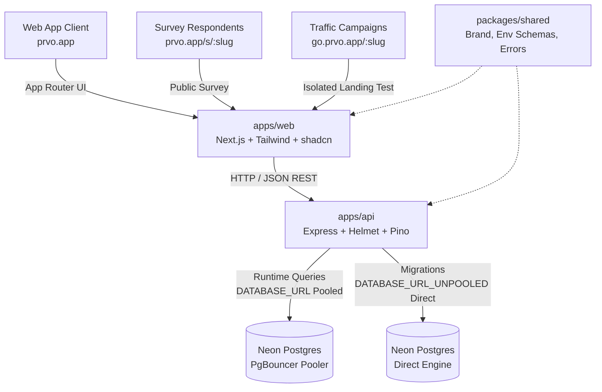

# Prvo (prvo.app) — Foundation

"Proof before you build."

Prvo is a web platform where early-stage founders submit a startup idea and get an evidence-backed validation verdict: an AI market and competitor analysis, a weighted score with a risk report, customer signal from surveys and landing-page tests, and community feedback.



---

## 1. Monorepo Architecture

- **`apps/web`**: Next.js 15 (App Router), Tailwind CSS, shadcn/ui primitives, TanStack Query, React Hook Form + Zod.
- **`apps/api`**: Express backend, Zod, Pino structured logging, Helmet, CORS allow-list, rate-limiting, graceful shutdown.
- **`packages/shared`**: Single source of truth for brand metadata (`brand.ts`), Zod-validated environment schemas (`env.ts`), and standard API error types (`errors.ts`).
- **Database**: PostgreSQL on Neon using Drizzle ORM and committed SQL migrations.

---

## 2. Environment Variables

Copy `.env.example` to `.env` in the root directory:

```bash
cp .env.example .env
```

| Variable | Required | Description | Default / Example |
|---|---|---|---|
| `DATABASE_URL` | Yes | Pooled connection string for runtime queries | `postgresql://...@...-pooler...neon.tech/neondb?sslmode=require` |
| `DATABASE_URL_UNPOOLED` | Yes | Direct connection string for DDL & migrations | `postgresql://...@...neon.tech/neondb?sslmode=require` |
| `APP_URL` | Yes | Web app URL origin | `http://localhost:3000` (prod: `https://prvo.app`) |
| `API_URL` | Yes | API URL origin | `http://localhost:4000` (prod: `https://api.prvo.app`) |
| `LANDING_URL` | Yes | Landing test isolated origin | `http://localhost:3001` (prod: `https://go.prvo.app`) |
| `PORT` | No | API HTTP server port | `4000` |
| `NODE_ENV` | No | Environment mode | `development` |
| `JWT_ACCESS_SECRET` | Yes | Minimum 32-character token secret | `[32+ character random secret]` |
| `JWT_REFRESH_SECRET` | Yes | Minimum 32-character refresh token secret | `[32+ character random secret]` |
| `ANTHROPIC_API_KEY` | Prod only | Claude API integration key | `sk-ant-...` |
| `ANTHROPIC_MODEL` | No | Model version | `claude-3-5-sonnet-20241022` |
| `TAVILY_API_KEY` | Prod only | Web search provider key | `tvly-...` |
| `BRAVE_API_KEY` | Prod only | Brave Search API key | `...` |
| `GOOGLE_CLIENT_ID` | Prod only | Google OAuth Client ID | `...` |
| `GOOGLE_CLIENT_SECRET` | Prod only | Google OAuth Client Secret | `...` |

---

## 3. Scripts

Run all scripts from the repository root:

- `pnpm install`: Install monorepo dependencies.
- `pnpm lint`: Run ESLint across all workspaces.
- `pnpm typecheck`: Run TypeScript compiler typechecks in strict mode.
- `pnpm test`: Execute Vitest unit and integration test suites.
- `pnpm build`: Compile all packages and build the Next.js frontend.
- `pnpm --filter @prvo/api db:generate`: Generate new SQL migrations from Drizzle schema.
- `pnpm --filter @prvo/api db:migrate`: Apply committed SQL migrations against Neon unpooled connection.
- `pnpm --filter @prvo/api db:studio`: Launch Drizzle Studio dashboard.

---

## 4. Operational Endpoints

- **`GET /health`**: Process liveness probe (returns HTTP 200).
- **`GET /ready`**: Readiness probe checking live database connection via `SELECT 1` (returns HTTP 200 when reachable, HTTP 503 if unreachable).

---

## 5. Design System Testbed

Start the web application and navigate to `/design`:
- Visual swatch display of all color tokens (vermilion, ink, paper, stone, verdigris).
- Interactive Light Mode / Dark Mode toggle.
- Four verdict tier badges with icons and labels (Brick 0–39, Ochre 40–59, Moss 60–79, Verdigris 80–100).
- Typography scale (Fraunces, Instrument Sans, IBM Plex Mono).
- Button, Input, and Card primitives.
